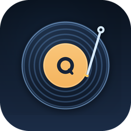

<p align="center">
  
</p>

<h1 align="center">QHIFI</h1>

<p align="center">
  <b>QPlayer 的 Android HiFi fork</b><br>
  以用户态 USB 独占输出为核心，保留 QPlayer 的 QML 界面、播放器与插件体系
</p>

<p align="center">
  
  
  
  
  <a href="LICENSE.md"></a>
</p>

***

## QHIFI 是什么

QHIFI 是 [QPlayer](https://github.com/TIMER-err/qplayer) 的社区 fork，面向 Android 上的
HiFi 播放场景。它沿用 QPlayer 的 `player-core`、QML/Miuix 界面和插件系统，同时把
**用户态 USB 独占输出**作为本 fork 的核心能力：应用直接接管 USB DAC，绕开 Android 的
AudioFlinger 与厂商 HAL，不再依赖系统混音链。

QHIFI 只发布 Android 安装包。仓库中的 `desktop-host` 保留用于共享 QML/`player-core`
的开发和验证，不是本 fork 的发行目标。

> QHIFI 是社区 fork，不是上游 QPlayer 的官方发行版。上游的功能与修复会定期合并；本 fork
> 的 USB 独占、音量体系和 QHIFI 设置是额外维护的部分。

## 核心特性

### 用户态 USB 独占输出

- 通过 `UsbManager` 取得 USB 设备权限，在 native 层用 **usbfs** 直接 claim DAC 的
  UAC 接口，绕开 `AudioFlinger`、AudioTrack 和厂商 HAL。

- 直接解析 UAC2 描述符（兼容 UAC1），选择 alt-setting，提交等时传输 URB，并读取反馈
  端点做时钟 pacing；不依赖 libusb，也不需要 root。

- 独占流按音源采样率打开；不经过系统重采样。音量拉满、不做数字衰减时，目标是
  bit-perfect 输出。

- 独占不可用或未授权时回退到系统音频路径；独占播放期间拔掉 DAC 同样会**暂停播放**，
  不切扬声器播放。

### 音量体系

独占路线和系统框架路线各自保存音量，互不继承：

- **硬件音量模式**：应用直接写 DAC 的 UAC2 音量控制，PCM 保持满幅；DAC 机身按钮与
  应用会互相覆盖。

- **软件音量模式**：完全不碰 DAC 硬件音量，DAC 机身按钮作为前级，应用在其下做数字
  衰减；两条路线不会争同一个控件。

- 独占软件音量使用感知曲线（位置的三次方），框架路径保持线性；两条路线的默认电平和
  曲线不同，切换输出时不会把一套音量直接套到另一条路线。

- 独占模式下显示音量 HUD；系统框架路径继续使用上游的原生音量语义。

### 播放、界面与歌词（继承上游）

- 本地媒体库、播放队列、列表循环 / 随机 / 单曲循环，前台 `MediaSession` 接管锁屏、
  通知栏和蓝牙控制。

- 沉浸歌词页的正文由宿主通过 Skija 直接绘制：逐字滚动、流体背景、翻译/罗马音；页面
  控件仍由 QML 渲染。

- Miuix QML 界面运行在 [qml4j](https://github.com/TIMER-err/qml4j) 上，窄屏底部导航、
  宽屏侧边栏，手机横屏和平板共用同一套响应式布局。

- 支持简体中文和英文、深浅色主题、封面取色和 Material 动效。

### 插件与在线音源

QHIFI 核心不包含在线音源端点，也不分发音源实现。在线能力通过 `.qplug` 插件提供：

- 插件在隔离的 Rhino Realm 中运行，按清单声明能力与权限；

- 内置插件目录只接受固定发布者的签名包；

- 插件不能提供 QML，只能返回声明式对话框描述，由宿主渲染；

- 音质开关保持上游的全局 `exhigh` / `standard` 语义，所有音源插件共用。

插件 ABI、权限、签名和凭据模型见 [插件开发文档](docs/plugins.md) 与
[插件安全模型](docs/plugin-security.md)。

### QHIFI 专有设置

设置页的 **QHIFI** tab 集中放置本 fork 的额外设置：

- USB 独占输出开关、输出设备选择、采样率跟随、音量模式；

- 后台保活音轨（实验，默认关闭）；

- 开启翻译结果保留（实验，默认关闭）。

“开启翻译结果保留”会把 qml4j 生成的界面类缓存到应用缓存，后续启动跳过 QML 的重复
编译。首次打开开关后的下一次启动仍会编译一次；安装或更新 APK 时缓存会与 D8 dex 缓存
一起失效。它只省 QML 编译，界面对象树、绑定和 Rhino JS 仍会在每次启动构建，因此是
“启动变快”，不是“秒开”。详见
[qml4j 启动编译分析](docs/qml4j-startup-compile-analysis.md)。

## 与上游 QPlayer 的关系

QHIFI 跟随上游 QPlayer 的版本号，版本格式为 `<上游版本>-hifi`，对应 tag 为
`v<上游版本>-hifi`。`master` 保留上游历史与真实的合并基，便于定期
`git merge upstream/master`；不要 rebase、重排或改写历史。

| 项目     | 上游 QPlayer           | QHIFI                     |
| ------ | -------------------- | ------------------------- |
| 发布平台   | Android + Desktop    | **仅 Android**             |
| 包名     | `dev.t1m3.qplayer`   | `com.kc0ver.qhifi`        |
| 应用名    | QPlayer              | QHIFI                     |
| 输出路径   | AAudio / Oboe / 系统音频 | 用户态 usbfs USB 独占（可选）      |
| 音量     | 上游原生逻辑               | 独占/框架双路线，硬件/软件音量分离        |
| 设置 tab | HiFi / 播放等           | 原 HiFi 设置并入 **QHIFI** tab |
| 启动编译   | 每次进程启动编译 QML         | QHIFI 可选持久化场景缓存（实验）       |
| CI     | 上游多平台                | 只构建 Android APK           |

上游新增的播放器功能、歌词、界面、插件和桌面修复会随合并进入本仓库；但本 fork 不发布
桌面安装包，也不承诺桌面端行为与上游发行版一致。

## 安装

### 要求

- Android 8.0 及以上（`minSdk 26`）；

- `arm64-v8a` 设备；

- 使用 USB 独占时，需要一台可通过 USB OTG 连接的 UAC DAC；

- 不需要 root。

### 下载与安装

1. 从 [Releases](https://github.com/kc0ver/qhifi/releases) 下载最新的
   `QHIFI-v<版本>.apk`。
2. 允许未知来源安装并安装 APK。
3. 首次启动时授予通知、媒体读取等必要权限；连接 USB DAC 时按系统弹窗授予 USB 访问权。

QHIFI 与上游 QPlayer 的包名和签名不同，不能直接覆盖安装上游版本，也没有自动数据迁移。
如果要同时安装多个构建：QHIFI 的 debug 变体使用 `.debug` 后缀，release 使用正式包名，
二者可以并存。

### 更新

同一签名的 QHIFI Release 可以直接覆盖安装。安装/更新后第一次启动会重新建立 QML 编译
缓存（如果开启了实验开关），这是正常行为；播放列表、设置和账号凭据会保留。

## 使用指南

### 本地播放

首次启动后授予媒体权限，应用会扫描设备音乐目录；也可以在设置中调整音乐文件夹。支持
本地播放列表、最近播放、队列和搜索。

### 在线音源

QHIFI 不内置在线音源。安装 `.qplug` 插件并登录后，推荐、歌单、搜索、喜欢等页面会按
插件声明的能力出现。未安装插件时，它仍然是一个完整的本地播放器。

### USB 独占

1. 用 OTG 连接 USB DAC。
2. 在系统弹窗中允许 QHIFI 访问该 USB 设备。
3. 打开 **设置 → QHIFI → USB 独占输出**。
4. 如需指定设备，在“输出设备”里选择 DAC；默认自动选择可用的 USB 音频设备。

独占模式下，建议在系统设置里为 QHIFI 关闭电池优化，避免部分 ROM 在后台压制进程。若
ROM 仍然把后台的本应用当作“未在放音”，可以打开“后台保活音轨（实验）”。独占路径完全
绕开 AudioFlinger，因此系统音量键通常不再调整这条流；请使用应用内音量控件。

### 音量模式怎么选

- 想让 DAC 的硬件音量控制由应用接管、PCM 保持满幅：选**硬件音量**。

- 想完全不动 DAC 硬件音量、把机身按钮作为前级：选**软件音量**。

两种模式不要混用；从一种切到另一种时，听到的响度可能变化，这是两条路线电平独立保存
的结果。

### 实验性的界面编译缓存

路径：**设置 → QHIFI → 启动 → 开启翻译结果保留（实验）**，默认关闭。

开启后，第一次启动会编译并保存 QML 生成的类，第二次启动开始复用；安装或更新 APK 后
缓存失效并重建。该功能只缓存编译结果，不缓存已经建好的界面对象，因此启动仍会执行对象
树和绑定的构建。

## 从源码构建

### 环境

- JDK 21；

- Maven 3.9+；

- Android SDK（compileSdk 34）与 NDK（版本由 `android-shell/app/build.gradle.kts` 指定）；

- Gradle wrapper 随仓库提供；

- Windows、macOS 或 Linux 均可构建 Android；本仓库的 CI 使用 Ubuntu。

### Android Debug

```sh
# 仓库根目录：安装共享模块到 Maven Local
mvn -B -pl player-core -am install -DskipTests

# 构建 debug APK
cd android-shell
./gradlew :app:assembleDebug
# Windows: .\gradlew.bat :app:assembleDebug
```

产物：`android-shell/app/build/outputs/apk/debug/app-debug.apk`。

### Android Release

Release 签名通过环境变量提供；没有 keystore 时 Gradle 会产出未签名 APK：

```sh
export QPLAYER_KEYSTORE=/path/to/qplayer.jks
export QPLAYER_STORE_PASSWORD=...
export QPLAYER_KEY_ALIAS=...
export QPLAYER_KEY_PASSWORD=...

cd android-shell
./gradlew :app:assembleRelease
```

产物：`android-shell/app/build/outputs/apk/release/app-release.apk`。CI 会把它重命名为
`QHIFI-v<版本>.apk` 并附到 Release；本地构建不会自动改名。

不要把 keystore、密码或 `local.properties` 提交到仓库。

### 测试

```sh
# 核心 JVM 测试
mvn -B -pl player-core test

# 桌面宿主测试（可选；桌面端不发布）
mvn -B -pl desktop-host test
```

`android-shell` 没有 `androidTest`；USB 独占、拔线、后台保活和在线源真实播放必须在
真机上验证。模拟器无法加载 arm64-only 原生库，也没有真实 USB 总线。

### 桌面宿主（仅开发）

桌面端用于共享 QML/`player-core` 的本地验证，QHIFI **不发布**桌面安装包：

```sh
mvn -B -pl player-core,desktop-host -am install
mvn -pl desktop-host exec:exec
```

### 发版

1. 同步更新 `android-shell/app/build.gradle.kts` 的 `versionCode`（+1）和
   `versionName`；`versionName` 保持 `<上游版本>-hifi`。
2. 更新 `.github/release-notes.md`：Release 的正文由该文件提供，包含 QHIFI 额外改动和
   本次合并的上游改动。
3. 提交并推送 `master`，然后创建 annotated tag：

```sh
git tag -a v<versionName> -m "QHIFI v<versionName>"
git push origin refs/tags/v<versionName>
```

例如 `versionName=1.8.6-hifi` 时，tag 是 `v1.8.6-hifi`。tag 必须与 `versionName`
严格一致，否则应用内更新检查和 CI 资产会对不上。

> 不要执行 `git push --tags`。仓库里同时存在上游的 `v1.8.6` 等 tag，整批推送可能触发
> 非 QHIFI 的 Release；只推送本次的 `v*-hifi` tag。

`release.yml` 只保留 Android job。CI 依赖四个仓库 secret：
`QPLAYER_KEYSTORE_BASE64`、`QPLAYER_STORE_PASSWORD`、`QPLAYER_KEY_ALIAS`、
`QPLAYER_KEY_PASSWORD`。签名密钥丢失后无法以同一签名更新已发布版本。

### 合并上游

上游仓库：<https://github.com/TIMER-err/qplayer>。合并时保留真实合并基，不要 rebase：

```sh
git remote add upstream https://github.com/TIMER-err/qplayer.git   # 只需一次
git fetch --tags upstream
git merge upstream/master
```

合并后至少重新构建三个模块，并确认 QML/native 改动没有被静默重复或覆盖：

```sh
mvn -B -N install -DskipTests
mvn -B -pl player-core install -DskipTests
mvn -B -pl desktop-host package -DskipTests
cd android-shell && ./gradlew :app:compileDebugJavaWithJavac  # 或 assembleDebug
```

## 项目结构

| 路径                                | 说明                                                                                   |
| --------------------------------- | ------------------------------------------------------------------------------------ |
| `player-core/`                    | 跨平台核心（Maven）：`PlayerController`、播放/队列、插件 ABI 与沙箱、歌词解析、资源与磁盘缓存、QML 场景缓存。**不含在线音源端点**。 |
| `shared-qml/`                     | 共享 QML：`Main.qml`、页面、组件、`miuix.Core`、字体。Android 与桌面开发宿主加载同一份。                        |
| `android-shell/`                  | Android 应用（Gradle）：`applicationId com.kc0ver.qhifi`，宿主集成、USB 权限与前台服务。                |
| `android-shell/app/src/main/cpp/` | 用户态 UAC 驱动：usbfs claim、UAC2 描述符解析、等时 URB、反馈端点。                                       |
| `desktop-host/`                   | 桌面开发宿主（Maven + LWJGL/GLFW + Skija）；QHIFI 不发布桌面版。                                     |
| `docs/`                           | 插件 ABI、安全模型、Miuix UI、Android 重建、QHIFI 待办与 qml4j 分析。                                  |
| `.github/`                        | Android-only Release 工作流、Release 正文模板、构建缓存。                                          |

相关文档：

- [插件 ABI](docs/plugins.md)

- [插件安全模型](docs/plugin-security.md)

- [Miuix 界面说明](docs/miuix-ui.md)

- [Android 内存重建](docs/android-memory-recreation.md)

- [QHIFI 待办与未完成项](docs/qplayer-hifi-phase2-plan.md)

- [qml4j 启动编译与场景缓存分析](docs/qml4j-startup-compile-analysis.md)

## 测试与已知边界

- **只发布 Android arm64**：原生 USB 驱动与 Skija 只编译 `arm64-v8a`；x86\_64 模拟器
  无法运行。

- **USB 独占需要真机**：模拟器没有真实 USB 总线，独占路径无法打开；拔线、后台和 DAC
  兼容性也必须在真机验证。

- **没有 androidTest**：自动化测试覆盖 `player-core` 的 JVM 逻辑和构建契约；独占音频、
  在线源和 ROM 后台行为只能人工验证。

- **桌面端不发布**：`desktop-host` 只用于共享 UI/逻辑的开发验证。

- **在线音源依赖插件**：核心不提供任何在线音源端点；插件签名、权限和可用性由插件侧
  决定。

- **首次启用界面缓存仍会编译一次**：这是设计行为，不是缓存失效错误。

- **部分 ROM 会压制后台应用**：独占输出绕开 AudioFlinger 后，系统可能把应用视为
  “未在放音”；可尝试关闭电池优化或开启后台保活音轨。

## 常见问题

**为什么独占模式下系统音量键没有反应？**
独占流不经过系统混音，音量由应用接管。请使用应用内的音量 HUD 或音量控件。

**为什么开启独占后，切回系统音频时音量不一样？**
独占与框架两条路线各自保存电平，默认值和曲线也不同；这是为了避免同一条曲线跨路线
产生响度跳变。

**为什么拔掉 USB DAC 后没有切到扬声器？**
独占模式下这是刻意行为：拔线即暂停，避免把 HiFi 流意外切到扬声器继续播放。

**为什么息屏或后台会无声？**
部分 ROM 会压制绕开音频框架的后台进程。先关闭 QHIFI 的电池优化；仍无效时可尝试
“后台保活音轨（实验）”。

**为什么更新后第一次启动又出现“正在编译界面组件”？**
如果开启了“翻译结果保留”，更新会使场景缓存与 D8 缓存一起失效，下一次启动重新编译
一次；之后的启动复用缓存。

**为什么不能直接覆盖安装上游 QPlayer？**
包名和签名都不同（`com.kc0ver.qhifi` 对 `dev.t1m3.qplayer`），需要卸载或并存安装；
本 fork 不提供自动数据迁移。

**为什么没有桌面版或 iOS 版？**
QHIFI 的目标是 Android 上的 USB 独占 HiFi 输出；桌面宿主只保留用于开发共享界面，
不发布。iOS 没有对应的 USB 独占路径。

**在线音源为什么是空的？**
核心不内置音源。安装 `.qplug` 插件并登录后，相关页面才会出现。

## 贡献

- 代码、文档和问题反馈欢迎提交到 [kc0ver/qhifi](https://github.com/kc0ver/qhifi)。

- 合并上游时保留真实合并基，不 rebase、不改写已发布历史；合并后实际编译验证。

- 修改 `player-core` 后先 `mvn -pl player-core install -DskipTests`，再构建 Android。

- 插件相关改动请先阅读 [插件 ABI](docs/plugins.md) 和
  [安全模型](docs/plugin-security.md)。

- 发版前更新 `.github/release-notes.md`，否则 Release 会沿用上一次的说明。

## 致谢

- [QPlayer](https://github.com/TIMER-err/qplayer) —— 本 fork 的上游播放器与共享核心。

- [qml4j](https://github.com/TIMER-err/qml4j) —— 纯 Java QML 引擎，驱动整套界面。

- [Skija](https://github.com/HumbleUI/Skija) —— JVM 上的 Skia 绑定，界面与歌词渲染。

- [miuix-qml](https://github.com/TIMER-err/miuix-qml) —— Miuix QML 组件库。

- [SPlayer](https://github.com/imsyy/SPlayer)、
  [AMLL](https://github.com/amll-dev/amll-player) —— 流体歌词与歌词动效的参考。

- [swingwebview](https://github.com/webliteca/swingwebview) —— 桌面端网页登录。

- 图标使用 Material Symbols Rounded。

## 许可证与声明

本项目使用 [Apache License 2.0](LICENSE.md)。`shared-qml/miuix` 中的组件库带有自己的
版本与许可说明，见 `shared-qml/miuix/`。

QHIFI 不提供在线音源，也不分发受版权保护的媒体。插件作者与用户需自行遵守服务条款和
当地法律。USB 独占会改变系统音频路由，使用前请确认设备和系统版本兼容；由此产生的
设备或听力风险由使用者自行承担。
